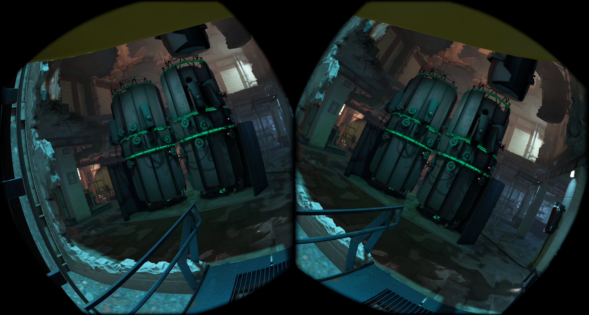

# Alyx Jailbreak — 0.203

[Русский](README.ru.md) · **English** · [Download APK](https://github.com/alferiko/alyx-jailbreak-releases/releases/latest)

Standalone Half-Life: Alyx launcher and ARM64 runtime. This repository contains release documentation and APK downloads.

## What's new

- Reduced the load from several demanding effects.
- Improved priority for transferring ready frames to the headset.
- Added a Dev Menu toggle to the launcher, enabled by default.
- Added an in-game VR console with a controller-operated keyboard, command history and game output. It is available next to Dev Menu and controlled by the same toggle.

Existing settings are preserved. Heavy diagnostics and per-frame profiling are disabled.

## Installation and updates

1. Download [Alyx-Jailbreak-0.203.apk](https://github.com/alferiko/alyx-jailbreak-releases/releases/download/v0.203/Alyx-Jailbreak-0.203.apk).
2. Install over the existing app using your headset's APK installer or `adb install -r Alyx-Jailbreak-0.203.apk`. The package and signing certificate are unchanged. Do not uninstall first if you want to preserve app preferences.
3. For a first installation, download game files through the launcher using your own Steam account with a Half-Life: Alyx license, or copy the **game** folder from your Windows installation to `/sdcard/AlyxJailbreak/game/`, including every VPK part and shader file. The Steam download option appears when no complete game installation is found.
4. Grant file access, check the game files and launch. The bundled ARM64 runtime is installed automatically.

Steam downloads can be paused and resumed; signing in again is required after restarting the app. The download includes resource compression. Steam Cloud import preserves existing local saves and does not upload files to Steam Cloud. Wait until all installation and compression steps finish before launching the game.

Saves are under `game/hlvr/save`; Workshop addons are under `game/hlvr_addons`. Launcher and game languages are selected separately. Graphics changes apply on the next game launch.

**Automatic update downloads are available on all supported headsets and enabled by default.** Checks run when opening the launcher, at most once every six hours; installation requires confirmation. The setting remains under your control. If you already installed the original 0.180 build 909, an older universal test or a separate PICO build, install the current APK manually once to enable future checks.

## Graphics and storage

Quality, Performance and Extreme modes are available alongside individual graphics controls. Use Restore my settings to return to your previous selection. Available controls depend on the headset. On PICO, use physical controllers; camera hand tracking is unavailable.

Resource compression can reduce detail. Stop safely restores only the unfinished file; completed files remain compressed. Restoring their original detail requires copying the original game files again. Saves, configuration, runtime and Workshop addons are outside the compression scan. Free space is required for temporary files and backups; follow the launcher's space checks and completion status.

## Recommended settings

Start with **Performance** and test a demanding scene in your own game. This is a starting point, not a promise of identical FPS on every headset. Change one option at a time, press Apply and restart the game. Updating the APK does not automatically replace saved preferences with the new preset.

| Preset | When to use it and what it sets |
|---|---|
| Performance | Suggested starting point: 67% render scale, TAAU where supported (otherwise AA off), strong peripheral detail reduction, simplified models, hidden vegetation, dynamic shadows, volumetric fog and heavy effects disabled. |
| Quality | With sufficient FPS headroom: 100%, MSAA 2× + TAA where supported (otherwise MSAA 2×), visible vegetation. Heavy effects and dynamic shadows remain suppressed; this is not the game's maximum quality. |
| Extreme | Enables low-memory optimization, initially 50%, AA and MQSR off. Noticeable blur or missing textures are possible; higher FPS is not guaranteed. |
| Restore my settings | Restores the manual choices saved before applying a preset. |

Presets select Headset timewarp, disable MQSR, and enable memory savings and render acceleration. On Quest, you can separately try **36 FPS + depth reprojection** where compatible with your AA mode; compare smoothness and distortions around moving objects. On PICO, use the available half-refresh-rate option. Available modes depend on the headset; a mode unsupported by your device being absent does not mean an incomplete installation.

### Antialiasing choices and screenshots

**[Open the interactive comparison](https://alferiko.github.io/alyx-jailbreak-releases/compare.en.html)** — select any two modes, drag the divider, choose either eye and inspect at 1:1 or 2:1. The original comparison controls are preserved; GitHub README cannot run JavaScript. The viewer supports Russian and English (RU / EN).

| Mode | Suggested use | Approximate measured FPS loss |
|---|---|---:|
| Off | Unfiltered sharpness; more jagged edges and shimmering thin lines. | Baseline |
| FDM + TAA | Temporal filtering in the sharp center; a starting point at 100% render scale. Moving objects can leave trails. | 10.8% |
| FDM + TAAU | Reconstructs the sharp center to 100% output resolution; ordinary scaling in the periphery. Start at 67% source resolution. | ≈0% at 67%* |
| SMAA | Current-frame filtering without temporal history; an alternative if you dislike TAA's appearance. | 9.3% |
| MSAA 2× | Geometry edge smoothing with additional rendering cost. | 17.2% |
| MSAA 2× + TAA | MSAA with temporal filtering in the center; needs more performance headroom. | 26.7% |
| MSAA 4× | More expensive geometry smoothing; test demanding scenes first. | 32.5% |

**Conditions:** Quest 3, build 3504, October 31, 2026, stationary headset, `s9/quick`, 100% render scale except TAAU (67%), Maximum VRS selected, 36 FPS limit. These are the earlier measurements used in the menu, not a new benchmark of build 3514. The comparison includes effective VRS limits: up to 4×4 for Off / SMAA / TAA / TAAU, 4×2 for MSAA 2× and the hybrid, and 2×2 for MSAA 4× on supported Quest devices.

\* TAAU was compared with AA off at the same 67% scale. Both hit the 36 FPS ceiling, so ≈0% **does not mean reconstruction is free**. One scene does not represent every map or headset.

These are the original stereo screenshots from that comparison. Open them at full size to inspect thin edges. Images are unretouched and not upscaled; still images cannot show shimmering or motion trails. Also compare TAAU at 67% with the separate Off-at-67% screenshot.

| Off — 100% | FDM + TAA — 100% |
|---|---|
|  |  |

| SMAA — 100% | MSAA 2× — 100% |
|---|---|
|  |  |

| MSAA 2× + TAA — 100% | MSAA 4× — 100% |
|---|---|
|  |  |

| Off — 67% | FDM + TAAU — 67% |
|---|---|
|  |  |

### Every graphics control

| Menu item | What it does and where to start |
|---|---|
| Reprojection and frame rate | Headset timewarp: 36 FPS / 72 Hz on Quest; positional correction needs the available system Positional time warp switch, which the app cannot enable or check. Depth reprojection uses scene depth. No additional limit removes the game's extra cap. System rotational correction remains active in every mode. PICO offers half the display refresh rate or no additional limit. |
| Prevent slowdown at low FPS | Helps maintain simulation speed during FPS drops, potentially increasing CPU load. Start with Off; does not apply with depth reprojection. |
| Render resolution | 100 / 85 / 75 / 67 / 55 / 50% scale width and height. Lower values reduce detail and load. Start at 67%, then increase with FPS headroom. |
| Dynamic resolution | Where available, adjusts between 50–92% targeting 36 FPS. Sharpness can change during play. |
| Valve Auto Fidelity | Alternative engine-managed automatic resolution, 50–92% targeting 36 FPS on supported Quest headsets. Use a fixed percentage first when comparing image quality. |
| Antialiasing | See the comparison above. Choices depend on headset and resolution. Selecting AA on supported Quest devices can enable VRS and limit its strength. |
| MQSR — image upscaling | Separate Quest upscaling enhancement, not a replacement for AA. Presets disable it; unavailable on PICO. Compare it at reduced resolution. |
| Image scaling | Soft/bilinear scaling reduces pixelation; sharp scaling keeps harder pixel boundaries. Some AA modes lock bilinear filtering while preserving your manual choice for compatible modes. |
| Maximum texture resolution | −1 uses game settings; 512 / 640 / 1024 / 2048 / 4096 px. This build starts at 512. Increase only with memory headroom; this cannot restore already compressed assets. |
| Texture mip offset | 0–3; higher values select less detailed levels. Start at 0. |
| Texture pool limit | 0 lets the game manage it; 512 / 768 / 1024 / 1536 MiB. Initial value: 512 MiB. This is a texture budget, not the whole game's memory limit; setting it too low can worsen streaming. |
| Disable dynamic shadows | Stops shadow-map rendering while preserving the flashlight and other lights; baked shading remains. Leave enabled for performance. |
| Render acceleration | Enables rendering optimizations. Recommended on, as in the presets. |
| VRS — reduce peripheral detail | Reduces edge detail while preserving a sharp center. Start with the preset and lower strength if peripheral detail is too coarse. On PICO it works with Off/SMAA; MSAA 2× temporarily disables it. |
| VRS strength | Low through Maximum among available levels. Effective limits depend on AA and headset; a stronger saved selection can be temporarily capped. |
| Disable volumetric fog | Removes volumetric fog, changing atmosphere and reducing its rendering cost. Enabled in Performance. |
| Memory savings (alpha) | Experimental memory reduction. Enabled in presets; does not guarantee protection against out-of-memory crashes. |
| Simplify vegetation | Reduces decorative vegetation range/density and uses less detailed models sooner. |
| Simplify model quality | Selects available lower-detail model variants earlier. Enabled in Performance; separate from heavy-effect suppression. |
| Hide vegetation | Hides decorative grass, bushes and trees. Gameplay plants and collisions remain. Unchecking shows the bundled simplified models. |
| Suppress heavy effects | Disables depth of field, bloom and indirect specular lighting; reduces selected decorative effects and simplifies vegetation. Leave enabled for performance. |
| Optimize for low-memory systems | Initially resets render scale to 50%, which remains adjustable. Disables AA/MQSR, uses maximum available VRS, 512 px textures, mip 3 and a 256 MiB pool, hides vegetation and suppresses shadows/effects. Controlled fields are locked; unchecking restores saved choices. Use only if the regular preset is insufficient. |
| Apply / Defaults | Saves changes / resets the section. Graphics changes apply at the next game launch. Defaults is not the same as the Performance preset. |

### Other menu sections

| Section and item | Purpose and recommendation |
|---|---|
| Main: Valve Dev Menu and Console | Shows Dev Menu and the VR console in the pause menu. Enabled by default; changes apply at the next launch. The console supports a controller keyboard, command history and game output. |
| Main: game folder | Folder name in headset storage, normally `AlyxJailbreak`. Change only if your files actually reside elsewhere. |
| Grant file access / Check files | Grant access and check completeness before launching. Checking also installs the bundled game runtime. |
| Steam game download | Sign in with your licensed account and wait for download/compression. Pause/resume keeps progress; restarting the app requires signing in again. Cloud-save import preserves existing local saves. |
| Cache compression | Reduces ordinary textures to 1024 px and simplifies suitable static models. Changes game files, not rendering preferences. Pause/resume controls processing; Stop safely restores only the unfinished file. Original resources are needed to restore original detail. |
| Game / launcher language | Selected separately. Game language needs its language files; voice acting remains English. |
| Track fingers with headset cameras | Quest finger animation only; controllers still determine hand pose. Requires system hand tracking. Unavailable on PICO. |
| Controls: left and right hands | Map trigger, grip, X/Y or A/B and stick press to a physical input or Disabled. Each input serves one action per hand; system buttons are unchanged. A button mapped to a trigger produces a full press. |
| Swap left and right stick functions | Swaps movement, crouch, turning and stick presses without reversing directions. Off by default. |
| Audio: synchronous mixer buffer | 50 / 75 / 100 / 1 ms. Start at 50 ms. Does not change the asynchronous audio queue; requires a full game restart. Volume is controlled in-game. |
| Saves | Refresh the list, continue the latest save or load a selected one. New game and chapter selection are in the game's own menu. |
| Shader preparation | Wait for the queue of supported AA modes: selected mode first, then the rest. The first pass can take time. |
| Help: updates | Automatic downloading is enabled by default. Check now checks manually; installing the downloaded APK requires confirmation. Release repository opens the release page. |

## Compatibility and checks

Targets: **Quest 2, Quest Pro, Quest 3, Quest 3S, PICO 4 and PICO 4 Ultra**. Version **0.203**, build **3614**; Android 10 or newer. Runtime is pinned to ARM64 depot `546564-20261027`; compatibility with arbitrary future game data is not guaranteed.

This exact APK passed package, configuration and targeted functional checks. The audited binary is published unchanged.

The release includes all 150 runtime files and all ten rendering variants, with heavy diagnostics and frame profiling disabled. Signature, package contents and release configuration are checked before publication. See [SHA256SUMS](SHA256SUMS.txt) for the APK checksum and [CHANGELOG](CHANGELOG.md) for release history.

## Support

- [DonationAlerts](https://dalink.to/zer0k0)
- [Patreon](https://www.patreon.com/cw/zer0k0)
- Crypto wallet: `0x4aF6a047C0B66d72d00455aea235F8c5aC529E9f`

Report problems in [Issues](https://github.com/alferiko/alyx-jailbreak-releases/issues). Include app version, headset/OS, graphics mode, map/save location, compression status and reproduction steps. Avoid sharing game content or private information in logs.

Unofficial project, not affiliated with Valve, Meta or PICO. Product names and trademarks belong to their owners. Third-party notices are included in the APK. No new source-code license is granted by this repository.
