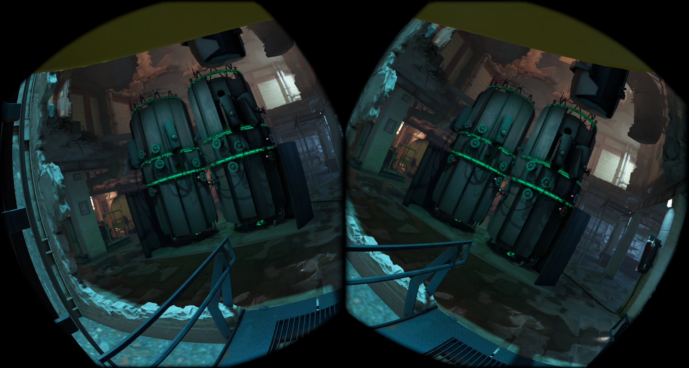

# Alyx Jailbreak — 0.202

**Русский** · [English](README.md) · [Скачать APK](https://github.com/alferiko/alyx-jailbreak-releases/releases/latest)

Автономный лаунчер Half-Life: Alyx и ARM64 runtime. Репозиторий содержит документацию и APK.

## Что нового

- Улучшена работа TAA и TAAU: обработка тонких деталей, устранение швов и уменьшение дополнительного размытия.
- Оптимизированы сглаживание и передача кадров, включён аппаратный resolve для MSAA 2×, 4× и MSAA+TAA.
- Обновлено меню сглаживания: добавлены ориентировочные показатели падения FPS и пояснения к замерам.
- Подготовка шейдеров теперь охватывает все поддерживаемые режимы сглаживания, начиная с выбранного.
- Обновлён пресет «Производительность»: 67% разрешения рендера, TAAU на поддерживаемых гарнитурах и упрощение моделей.
- Добавлена возможность менять разрешение при включённой оптимизации памяти.
- Оптимизированы интерфейс станка и обработка непрозрачных объектов.
- Добавлена настройка объёмного тумана, исправлено переключение динамических теней.

Существующие настройки сохраняются. Обновлённые параметры пресета применяются при его выборе.

## Установка и обновление

1. Скачайте [Alyx-Jailbreak-0.202.apk](https://github.com/alferiko/alyx-jailbreak-releases/releases/download/v0.202/Alyx-Jailbreak-0.202.apk).
2. Установите поверх приложения привычным установщиком APK или командой `adb install -r Alyx-Jailbreak-0.202.apk`. Пакет и сертификат подписи прежние. Не удаляйте приложение перед обновлением, чтобы сохранить его настройки.
3. При первой установке скачайте игровые файлы через лаунчер со своего аккаунта Steam с лицензией Half-Life: Alyx либо скопируйте папку **game** из Windows-установки в `/sdcard/AlyxJailbreak/game/`, включая все части VPK и шейдеры. Загрузка через Steam появляется, если полная установка игры не найдена.
4. Разрешите доступ к файлам, проверьте игровые файлы и запустите игру. Встроенный ARM64 runtime устанавливается автоматически.

Загрузку из Steam можно приостановить и продолжить; после перезапуска приложения потребуется повторный вход. Во время установки выполняется сжатие ресурсов. Импорт Steam Cloud сохраняет существующие локальные сохранения и ничего не загружает в облако. Перед запуском игры дождитесь завершения всех этапов установки и сжатия.

Сохранения находятся в `game/hlvr/save`, аддоны Workshop — в `game/hlvr_addons`. Языки лаунчера и игры выбираются отдельно. Настройки графики применяются при следующем запуске игры.

**Автоскачивание обновлений доступно на всех поддерживаемых гарнитурах и включено по умолчанию.** Проверка выполняется при открытии лаунчера, не чаще раза в шесть часов; установка требует подтверждения. Автоскачивание можно отключить в настройках. Если уже установлена первоначальная 0.180 / v909, прежняя универсальная тестовая или отдельная PICO-сборка, один раз установите текущий APK вручную — после этого заработают дальнейшие проверки.

## Графика и хранение

Доступны режимы «Качество», «Производительность» и Extreme, а также отдельные параметры графики. Кнопка «Вернуть мои настройки» возвращает прежний выбор. Доступность параметров зависит от гарнитуры. На PICO используйте физические контроллеры: отслеживание рук камерами недоступно.

Сжатие ресурсов может снижать детализацию. «Завершить досрочно» восстанавливает только незавершённый файл; уже обработанные остаются сжатыми. Чтобы вернуть исходную детализацию, скопируйте оригинальные файлы игры заново. Сохранения, настройки, runtime и аддоны Workshop не входят в область сжатия. Для временных файлов и резервных копий нужно свободное место; ориентируйтесь на проверку места и сообщение о завершении в лаунчере.

## Рекомендованные настройки

Начните с «Производительность» и проверьте тяжёлую сцену в своей игре. Это отправная точка, а не гарантия одинакового FPS на всех шлемах. Изменяйте по одному параметру, нажимайте «Применить» и полностью перезапускайте игру. При обновлении сохранённые параметры не заменяются новым пресетом автоматически.

| Вариант | Когда выбирать и что он задаёт |
|---|---|
| Производительность | Рекомендуемая отправная точка: рендер 67%, TAAU при его доступности (иначе без AA), сильное снижение детализации периферии, упрощение моделей, скрытая растительность, отключённые динамические тени, объёмный туман и тяжёлые эффекты. |
| Качество | При достаточном запасе FPS: 100%, MSAA 2× + TAA при поддержке (иначе MSAA 2×), видимая растительность. Тяжёлые эффекты и динамические тени всё ещё подавлены; это не максимальные настройки игры. |
| Экстрим | Для особо тяжёлых сцен: включает «Оптимизацию для слабых систем», первоначально 50%, без AA и MQSR. Возможны заметное размытие и пропадание текстур; выше FPS не гарантируется. |
| Вернуть мои настройки | Возвращает ручной выбор, сохранённый до применения пресета. |

Пресеты выбирают системный Headset timewarp, отключают MQSR и включают экономию памяти и ускорение рендера. На Quest можно отдельно попробовать **36 FPS + репроекцию по глубине**, если она доступна с выбранным сглаживанием: оцените плавность и возможные искажения на движущихся объектах. На PICO используйте доступный пункт половины частоты дисплея. Список режимов зависит от гарнитуры; отсутствие недоступного ей режима не означает неполную установку.

### Сглаживание: выбор и сравнение

**[Открыть интерактивное сравнение](https://alferiko.github.io/alyx-jailbreak-releases/compare.html)** — выбор любых двух режимов, ползунок, левый/правый глаз, масштаб 1:1 и 2:1. Механизм сравнения сохранён; прямо внутри GitHub README JavaScript не запускается.

| Режим | Для чего подходит | Ориентировочное падение FPS в замере |
|---|---|---:|
| Отключено | Максимальная резкость без фильтра; ступеньки и мерцание тонких линий заметнее. | База сравнения |
| FDM + TAA | Временное сглаживание чёткого центра; хороший вариант при 100% рендера. В движении возможны шлейфы. | 10,8% |
| FDM + TAAU | Реконструкция чёткого центра до выходного разрешения 100%, периферия масштабируется обычным способом. Начните с 67% исходного рендера. | ≈0% при 67%* |
| SMAA | Сглаживание текущего кадра без временной истории; вариант, если не нравится характер TAA. | 9,3% |
| MSAA 2× | Сглаживание краёв геометрии с дополнительной нагрузкой. | 17,2% |
| MSAA 2× + TAA | MSAA вместе с временным сглаживанием центра; для большего запаса производительности. | 26,7% |
| MSAA 4× | Более затратное сглаживание геометрии; используйте после проверки тяжёлых сцен. | 32,5% |

**Условия:** Quest 3, сборка 3504, 31 октября 2026 года, неподвижный шлем, сохранение `s9/quick`, 100% рендера кроме TAAU (67%), выбран максимальный VRS, ограничение 36 FPS. Это прежние замеры, используемые в меню, а не повторный тест сборки 3514. Сравнение включает аппаратные ограничения VRS: до 4×4 без AA / SMAA / TAA / TAAU, до 4×2 с MSAA 2× и гибридом, до 2×2 с MSAA 4× на поддерживаемых Quest.

\* TAAU сравнивался с выключенным AA при тех же 67%. Оба режима достигали потолка 36 FPS, поэтому ≈0% **не означает бесплатную реконструкцию**. Результаты одной сцены нельзя переносить на все карты и гарнитуры.

Ниже — исходные стереокадры того же сравнения. Откройте изображение в полном размере для просмотра тонких линий. Кадры не ретушировались и не увеличивались; снимок не показывает мерцание или шлейфы в движении. TAAU при 67% следует сравнивать также с отдельным кадром без AA при 67%.

| Off — 100% | FDM + TAA — 100% |
|---|---|
|  |  |

| SMAA — 100% | MSAA 2× — 100% |
|---|---|
|  |  |

| MSAA 2× + TAA — 100% | MSAA 4× — 100% |
|---|---|
|  |  |

| Off — 67% | FDM + TAAU — 67% |
|---|---|
|  |  |

### Все параметры графики

| Пункт меню | Что делает и с чего начать |
|---|---|
| Репроекция и частота кадров | Headset timewarp: 36 FPS / 72 Гц на Quest; коррекция положения требует доступного системного переключателя Positional time warp. Приложение не включает и не проверяет его. «36 FPS + репроекция по глубине» использует глубину сцены. «Без дополнительного ограничения» снимает ограничитель игры. Системная коррекция поворота головы остаётся во всех режимах. На PICO — половина частоты дисплея или без дополнительного ограничения. |
| Предотвращать замедление при низком FPS | Помогает сохранять скорость симуляции при просадках, но может увеличить нагрузку CPU. Начните с выключенного; с репроекцией по глубине не применяется. |
| Разрешение рендера | 100 / 85 / 75 / 67 / 55 / 50% — масштаб по ширине и высоте. Ниже — меньше нагрузка и детализация. Начните с 67%, затем повышайте при запасе FPS. |
| Динамическое разрешение | Если доступно, изменяет масштаб в пределах 50–92% с целью 36 FPS. Чёткость может меняться во время игры. |
| Valve Auto Fidelity | Альтернативное автоматическое управление разрешением средствами движка, 50–92% с целью 36 FPS. Доступно на поддерживаемых Quest; для сравнения качества сначала используйте фиксированный процент. |
| Сглаживание | См. таблицу выше. Доступные варианты зависят от шлема и разрешения. На поддерживаемых Quest выбор AA может включить VRS и ограничить его силу. |
| MQSR — улучшение масштабирования | Отдельный способ улучшения масштабирования на Quest; не заменяет AA. В пресетах выключен, на PICO недоступен. Включайте для сравнения при пониженном разрешении. |
| Масштабирование изображения | Мягкое (билинейное) уменьшает пикселизацию; резкое сохраняет более жёсткие границы пикселей. Некоторые AA фиксируют билинейный фильтр; ручной выбор сохраняется для совместимого режима. |
| Максимальное разрешение текстур | −1: настройка игры; 512 / 640 / 1024 / 2048 / 4096 px. Исходная настройка текущей сборки — 512. Повышайте только при запасе памяти; уже сжатые ресурсы от этого не восстановятся. |
| Смещение mip-уровня текстур | 0–3; большее значение выбирает менее детальные уровни. Начните с 0. |
| Предел пула текстур | 0: управление игрой; 512 / 768 / 1024 / 1536 МиБ. Начальная настройка — 512 МиБ. Это отдельный бюджет текстур, а не предел всей памяти; слишком малый пул может ухудшить подгрузку. |
| Отключить динамические тени | Отключает построение карт теней; фонарик и другие источники света сохраняются, запечённое затенение остаётся. Для производительности оставьте включённым. |
| Ускорение рендера | Включает оптимизации обработки рендера. Рекомендуется оставить включённым, как в пресетах. |
| VRS — снижение детализации периферии | Уменьшает детализацию по краям изображения, сохраняя чёткий центр. Больше сила — выше потеря периферийных деталей. Начните с пресета, уменьшите силу, если края слишком грубые. На PICO VRS работает без AA и с SMAA, а MSAA 2× временно его отключает. |
| Сила VRS | От слабого до максимального среди доступных уровней. Фактический предел зависит от AA и гарнитуры; сохранённый более сильный уровень может быть временно ограничен. |
| Выключить объёмный туман | Убирает объёмный туман, меняя атмосферу сцены и снижая связанную с ним нагрузку. В «Производительности» включено. |
| Экономия памяти (alpha) | Экспериментально снижает потребление памяти. Включена в пресетах, но не гарантирует защиту от нехватки памяти. |
| Упрощение растительности | Снижает дальность и плотность декоративной растительности, раньше выбирает менее детальные модели. |
| Упрощение качества моделей | Раньше использует доступные менее детальные варианты моделей. Включено в «Производительности»; настраивается отдельно от тяжёлых эффектов. |
| Отключить растительность | Скрывает декоративные траву, кусты и деревья. Игровые растения и столкновения сохраняются. Снятие галочки возвращает поставляемые упрощённые модели. |
| Подавление тяжёлых эффектов | Отключает глубину резкости, свечение и непрямой зеркальный свет, сокращает отдельные декоративные эффекты и упрощает растительность. Для производительности оставьте включённым. |
| Оптимизация для слабых систем | Сбрасывает рендер на 50%, затем его можно менять. Отключает AA/MQSR, задаёт максимальный доступный VRS, текстуры 512 px, mip 3 и пул 256 МиБ, скрывает растительность и подавляет тени/эффекты. Управляемые поля блокируются; снятие галочки возвращает сохранённый выбор. Используйте только если обычного пресета недостаточно. |
| Применить / По умолчанию | Сохраняет изменения / сбрасывает параметры раздела. Графические изменения применяются при следующем запуске игры. «По умолчанию» не равно пресету «Производительность». |

### Остальные разделы меню

| Раздел и пункт | Назначение и рекомендация |
|---|---|
| Основное: папка игры | Имя папки внутри памяти шлема; обычно `AlyxJailbreak`. Меняйте только если файлы действительно лежат в другой папке. |
| Разрешить доступ к файлам / Проверить кеш | Выдайте доступ и проверьте комплектность перед запуском. Проверка также устанавливает встроенное окружение игры. |
| Загрузка игры из Steam | Войдите своим аккаунтом с лицензией, дождитесь загрузки и сжатия. Пауза/продолжение сохраняют прогресс; после перезапуска нужен повторный вход. Импорт облачных сохранений не перезаписывает существующие локальные. |
| Сжатие кеша | Уменьшает обычные текстуры до 1024 px и облегчает подходящие статические модели. Это изменение игровых файлов, а не настройка рендера. Пауза/продолжение управляют процессом; «Завершить досрочно» восстанавливает только незавершённый файл. Для возврата исходного качества нужны оригинальные ресурсы. |
| Язык игры / язык лаунчера | Выбираются отдельно. Для языка игры нужны соответствующие файлы; озвучка остаётся английской. |
| Отслеживать пальцы камерами гарнитуры | На Quest анимирует пальцы; положение кистей по-прежнему задают контроллеры. Нужен включённый системный трекинг рук. На PICO недоступно. |
| Управление: левая и правая рука | Для триггера, хвата, X/Y или A/B и нажатия стика выберите физический источник либо «Отключено». Одна кнопка — одно действие на руке; системные кнопки не переназначаются. Кнопка вместо триггера даёт полное нажатие. |
| Зеркалировать назначения стиков | Меняет между руками движение, присед, поворот и нажатия стиков без инверсии направлений. По умолчанию выключено. |
| Звук: запас синхронного микшера | 50 / 75 / 100 / 1 мс. Начните с 50 мс. Не меняет очередь асинхронного звука; применяется после полного перезапуска. Громкость регулируется в игре. |
| Сохранения | Обновить список, продолжить последнее или загрузить выбранное сохранение. Новая игра и выбор главы доступны в меню самой игры. |
| Подготовка шейдеров | Дождитесь завершения очереди поддерживаемых AA-режимов: сначала выбранный, затем остальные. Первый проход может занять время. |
| Справка: обновления | Автоскачивание включено по умолчанию. «Проверить обновления» запускает проверку вручную; готовый APK устанавливается с подтверждением. Ссылка на репозиторий ведёт к релизам. |

## Совместимость и проверки

Целевые гарнитуры: **Quest 2, Quest Pro, Quest 3, Quest 3S, PICO 4 и PICO 4 Ultra**. Версия **0.202**, сборка **3514**; Android 10 или новее. Runtime закреплён за ARM64-депо `546564-20261027`; совместимость с произвольными будущими версиями игровых данных не гарантируется.

Для этого APK проверены содержимое пакета, конфигурация и работа отдельных функций. Проверенный файл опубликован без изменений.

Включены все 150 файлов runtime и десять вариантов рендера; тяжёлая диагностика и покадровое профилирование выключены. Перед публикацией проверяются подпись, содержимое APK и релизная конфигурация. Контрольная сумма — в [SHA256SUMS](SHA256SUMS.txt), история выпусков — в [CHANGELOG](CHANGELOG.md).

## Поддержать разработку

- [DonationAlerts](https://dalink.to/zer0k0)
- [Patreon](https://www.patreon.com/cw/zer0k0)
- Криптокошелёк: `0x4aF6a047C0B66d72d00455aea235F8c5aC529E9f`

Сообщайте об ошибках в [Issues](https://github.com/alferiko/alyx-jailbreak-releases/issues). Укажите версию приложения, шлем/ОС, режим графики, карту/сохранение, состояние сжатия и шаги воспроизведения. Не публикуйте игровые данные или личную информацию из логов.

Неофициальный проект, не связанный с Valve, Meta или PICO. Названия и товарные знаки принадлежат владельцам. Уведомления о сторонних компонентах включены в APK. Новая лицензия на исходники этим репозиторием не предоставляется.
